# Cybersecurity Plan for Revelator

## Cover Page

Laguna State Polytechnic University  
Province of Laguna  
College of Computer Studies  
ITEP 413 – Information Assurance and Security  

Final Project: Cybersecurity Plan for the Capstone System  

Title: Revelator – Document Forgery Screening and Analysis System

Prepared by: Revelator Capstone Team  
Submitted to: ITEP 413 Faculty / Instructor  

Date: November 2026

---

## 1. System Overview and Asset Inventory

### 1.1 System Description

Revelator is a web and mobile-capable system designed to analyze document images for signs of forgery, alteration, tracing, or digital manipulation. It is intended as a decision-support tool for forensic document review rather than an ultimate legal or forensic authority. The application allows users to upload an image of a physical document, run it through an AI-based analysis pipeline, and receive a result indicating whether the document appears forged, suspicious, or authentic.

The system is built around a React frontend and a FastAPI backend. The frontend supports user sign-in, image capture or file upload, scan submission, and display of results. The backend handles authentication, request validation, document analysis, AI model invocation, database access, and storage of upload metadata. The application also includes an administrative layer for monitoring events, account activity, and operational logs.

The actual project architecture currently includes:

- React frontend with Vite and Capacitor support for web and Android deployment
- FastAPI backend with JWT-based authentication and routed endpoints
- SQLAlchemy and SQLite for persistence
- Gemini Vision for document classification
- Optional local classifier and optional document gate using Groq or Ollama
- Uploaded image storage and metadata tracking
- Password reset, email verification, Google sign-in, and saved API keys

### 1.2 Business Use Case

The system is used by a user who needs to screen a document for tampering or forgery, such as:

- government IDs and licenses
- certificates and official forms
- receipts and financial records
- utility or personal document submissions

The target users include:

- end users submitting document scans for review
- administrators managing users, logs, and system activity
- evaluators or analysts reviewing scan history and security events

### 1.3 Major Components

1. Client Layer
   - React web interface
   - Mobile-capable frontend using Capacitor
   - Authentication UI, upload page, scan history, account management

2. API Layer
   - FastAPI routes for authentication, analysis, accounts, admin, and payments
   - Security middleware, CORS, request validation, response headers
   - Health monitoring and request tracking

3. AI Analysis Layer
   - Gemini Vision classification model
   - Structured categories for forged methods and fallback categories
   - Document gate to detect whether the input is actually a document
   - Optional local classifier and confidence review for doubtful results

4. Persistence Layer
   - SQLite database by default
   - User accounts, roles, scans, API keys, verification tokens, audit logs

5. Storage Layer
   - Uploaded document images stored in a local upload directory
   - Database stores metadata and result records separately from the files

6. Supporting Services
   - Email delivery for account verification or password reset
   - Optional payment integration via Stripe and webhook support
   - Operational logging for failed requests and system events

### 1.4 Asset Inventory

| Asset | Description | Sensitivity |
|---|---|---|
| User credentials | Password hashes, email, username, role metadata | High |
| JWT tokens | Access and refresh tokens used for session control | High |
| Uploaded images | Scanned or photographed document files | High |
| Scan metadata | Verdict, confidence, category, evidence, timestamps | High |
| Gemini API keys | Model access credentials | High |
| Admin and user roles | Access control and privilege information | High |
| SQLite database | Stores accounts, scans, audit data, and settings | High |
| application logs | Request failures, operational events, security events | Medium |
| Google OAuth configuration | Client ID and secret used in sign-in flow | High |
| SMTP credentials | Email send settings for verification flows | Medium |
| Stripe keys | Payment integration credentials | High |

### 1.5 User Roles and Access Levels

The system contains functions for multiple roles, including:

- End User: uploads documents, views own scan history, manages own profile
- Admin: monitors system events, manages users or platform-level settings
- Super Admin: highest privileges used for administrative oversight

Access control is implemented using role-based permission checks and JWT authentication. The backend validates that the caller is authorized before allowing access to privileged routes.

### 1.6 Data Handled by the System

The application handles both operational and personal data:

- user identity data
- authentication tokens and login records
- saved API keys
- uploaded images and analysis results
- audit and diagnostic logs
- optional payment metadata if integrated with Stripe

Because the application processes document images and account data, it qualifies as a system that should apply basic confidentiality, integrity, and availability controls.

---

## 2. Risk and Threat Assessment

### 2.1 Threat Model and OWASP Mapping

The most relevant OWASP Top 10 items for Revelator are:

- A01: Broken Access Control
- A02: Cryptographic Failures
- A03: Injection
- A04: Insecure Design
- A05: Security Misconfiguration
- A06: Vulnerable and Outdated Components
- A07: Identification and Authentication Failures
- A08: Software and Data Integrity Failures
- A09: Security Logging and Monitoring Failures
- A10: Server-Side Request Forgery (SSRF) / unsafe external integrations

### 2.2 Risk Table

| Threat | OWASP Mapping | Likelihood | Impact | Justification |
|---|---|---|---|---|
| Unauthorized access to admin or user data | A01 | High | High | The system uses role-based access and JWTs, but a missing permission check or broken token handling could expose private scans or admin features. |
| Password compromise or weak auth | A07 | Medium | High | User accounts and Google sign-in require secure handling, and account takeover could expose uploaded documents and stored metadata. |
| Insecure storage of API keys or secrets | A02 | Medium | High | The app stores Gemini keys, Google credentials, SMTP settings, and Stripe configuration, which must be protected from leakage. |
| Malicious or oversized uploads | A03, A05 | High | Medium | The backend processes user images and must validate file type, extension, and size to avoid crashes or malicious payload issues. |
| Prompt injection or untrusted AI input | A03, A04 | Medium | Medium | The classifier uses user content and model prompts; if user-provided text is included in prompts or external inputs are treated as trusted, manipulation may occur. |
| Cross-site request forgery or CORS bypass | A05 | Medium | Medium | The app uses CORS middleware and request headers; an incorrect origin policy may allow unauthorized browser-origin interactions. |
| Excessive log leakage or poor monitoring | A09 | Medium | High | If failed requests and operational events are not properly monitored, security incidents may go unnoticed. |
| Unsafe external service calls | A10 | Medium | Medium | External integrations such as Gemini, Groq, Ollama, Google OAuth, and Stripe require careful validation to avoid unsafe requests or misuse. |
| Out-of-date libraries or dependency drift | A06 | Medium | Medium | The backend and frontend depend on multiple open-source packages, and stale versions may contain known vulnerabilities. |
| Availability disruption | A05, A04 | Medium | Medium | A malformed upload, failed model call, or database issue could interrupt system operations or deny users service. |

### 2.3 Threat Analysis for the Revelator System

The most relevant risks are tied to the app’s actual design:

- The system accepts user-provided files and processes them with external AI systems.
- It stores sensitive data such as user identity, uploaded documents, and AI scan results.
- It supports role-based access, but the application depends on proper enforcement of those checks.
- It contains multiple integration points: Google OAuth, Gemini API, optional Groq/Ollama, email delivery, and Stripe.
- It operates in a local environment by default but may be deployed publicly, increasing the need for secure configuration.

Because this is a real system being built for a capstone project, the risk assessment must be tied to the current implementation rather than abstract security concerns. The specific concerns are not hypothetical—they arise from actual endpoints, tokens, models, logs, file uploads, and external providers used by the project.

---

## 3. Security Controls and Architecture

### 3.1 Recommended Architecture

The system should be deployed behind a layered architecture.

```text
Internet
   |
   v
WAF / reverse proxy (Cloudflare or NGINX)
   |
   v
Frontend (React / Vite production build)
   |
   v
FastAPI backend
   |-- JWT auth / role checks
   |-- upload validation
   |-- AI analysis / document gate
   |-- app logs and operational events
   |
   v
Database (SQLite in development, PostgreSQL or managed DB in deployment)
   |
   v
Storage (uploaded images / local or object storage)
   |
   v
External services (Gemini, Google OAuth, SMTP, Stripe)
```

### 3.2 Authentication and Session Management

The application currently implements JWT access tokens and refresh tokens, and password hashing with bcrypt. This is a strong baseline for a web application.

Recommended controls:

- Require secure password policies for user registration
- Keep JWT tokens short-lived and refresh tokens rotated
- Validate token type and expiry before every protected request
- Use HTTP-only secure cookies when possible for refresh tokens if the frontend is configured to support them
- Enforce email verification for new registrations where email delivery is configured
- Support MFA or 2FA for high-risk logins when the environment allows it
- Reject stale or tampered tokens explicitly at the API layer

How it addresses the threat:

This reduces authentication bypass, token theft, and unauthorized access to user data and admin functions.

### 3.3 Authorization and Access Control

The project already includes role checks and permission-aware dependencies in the backend. This is important because document scans and admin endpoints should never be visible to unrelated users.

Recommended controls:

- Enforce ownership checks on scan history and uploaded files
- Restrict admin endpoints to authorized roles only
- Log every authorization failure for investigation
- Validate user roles before performing state-changing operations

How it addresses the threat:

This mitigates broken access control, one of the most serious risks in SaaS applications.

### 3.4 HTTP Security and Browser Controls

The backend includes security middleware that applies:

- CORS origin restrictions
- request origin checks
- X-Content-Type-Options: nosniff
- X-Frame-Options: DENY
- Referrer-Policy
- Permissions-Policy
- Cache-Control: no-store on API routes
- Content-Security-Policy

These are important controls because the app exposes a browser-based interface and handles user uploads.

Recommended additional controls:

- Use a strict allowlist of front-end origins instead of wildcard CORS in production
- Consider HSTS in HTTPS deployments
- Ensure the app is always served over HTTPS, not mixed HTTP

How it addresses the threat:

This reduces browser-based attacks, cross-origin abuse, and content injection.

### 3.5 Input Validation and File Handling

The project’s core flow uploads files, preprocesses images, and sends them to AI services. This is a high-risk interaction point.

Recommended controls:

- Restrict allowed file types to image MIME types and a finite list of approved extensions
- Enforce maximum upload size
- Validate and normalize file names to avoid path traversal issues
- Scan uploaded files at the application boundary before storing or processing
- Reject non-document images before model classification
- Store uploads outside the web root or in a secure application storage directory

How it addresses the threat:

This reduces malicious file injection, resource exhaustion, and storage abuse.

### 3.6 Secret Management and Data Protection

The system stores API keys and configuration values in environment variables and project configuration. This is good practice, but production deployments must be hardened.

Recommended controls:

- Store secrets in a vault or managed environment store, not in source files or plain deployment scripts
- Encrypt sensitive stored values where appropriate
- Use separate keys for development and production
- Restrict access to admin configuration and secret files
- Rotate credentials frequently

How it addresses the threat:

This protects Gemini, Google, Stripe, SMTP, and database-related credentials from exposure.

### 3.7 AI and External Service Security

The project integrates with external AI services such as Gemini and optionally Groq or Ollama. This increases the security surface because the app depends on third-party services for result generation.

Recommended controls:

- Validate all responses from external AI services before using them in the application
- Treat provider results as untrusted until validated
- Limit the size and frequency of requests to prevent abuse
- Log provider failures, rate limits, and timeouts
- Use fallback models carefully and avoid exposing raw provider errors to users

How it addresses the threat:

This reduces API abuse, model failure impacts, and integrity problems from untrusted external responses.

### 3.8 WAF and Firewall Placement

Because the application is a public-facing SaaS system, a firewall and WAF should sit in front of the web server.

Recommended placement:

- Public traffic enters a WAF or CDN layer first
- WAF blocks malicious requests, bot traffic, malformed requests, and known exploit patterns
- Backend runs behind a reverse proxy and internal firewall rules
- Database and storage remain isolated from direct public access
- Only required ports are exposed to the internet

How it addresses the threat:

A WAF reduces common web attacks before the application processes them.

### 3.9 Security Logging and Monitoring

The backend includes operational event logging. This is useful and should be extended into a formal monitoring practice.

Recommended controls:

- Store failed authentication and authorization attempts
- Track abnormal upload behavior, rate-limit events, and model-service failures
- Set alerts for repeated 401/403/429 responses or unusual patterns
- Store a request ID with each major event to support incident investigation
- Review logs on a regular schedule

How it addresses the threat:

This supports faster detection and response to attacks, misuses, and service disruption.

---

## 4. Standards Alignment

### 4.1 Mapping to ISO/IEC 27002

The project aligns with several ISO/IEC 27002 control themes, especially the security domains relevant to web application protection.

| Proposed Control | ISO/IEC 27002 Theme | Explanation |
|---|---|---|
| User authentication and role checks | Access control | Ensures only authorized users can view scans and admin data. |
| Password hashing and JWT validation | Identity and access management | Protects credentials and secures user sessions. |
| Input validation and upload restrictions | Secure development and operations | Ensures safer handling of untrusted files and user content. |
| Security headers and origin restrictions | Network and application security | Reduces browser-based exploitation and cross-site abuse. |
| Logging, monitoring, and event tracking | Logging and monitoring | Supports detection of failed requests and traceability of incidents. |
| Secret management and configuration hardening | Cryptography and key management | Protects API keys and sensitive deployment settings. |
| WAF and reverse proxy placement | Network security | Adds defense-in-depth before requests reach the application. |

### 4.2 PCI DSS Consideration

The Revelator system does not directly process payment card data in the core workflow. The uploaded documents are not stored as payment records, and the main application is not designed to handle cardholder data. The project currently uses optional Stripe integration for payment features, but the primary business logic does not require collecting full card credentials within the application.

Because of this design, PCI DSS is not fully applicable to the core application, but it still matters for any deployment that stores or processes payment data directly. The app should ensure that:

- webhook secrets are protected
- payment-related API keys are stored securely
- any payment flow is isolated from the document-analysis workflow
- cardholder data is never saved in the application database or upload storage

This means the project is not a full PCI scope environment, but it still needs to follow secure practices around third-party payment integration.

### 4.3 Data Privacy Considerations

The system processes personal and sensitive information, including:

- user identity data
- personal documents
- uploaded evidence files
- analysis results

Under Philippine law, the Data Privacy Act of 2012 (Republic Act No. 10173) is relevant if personal data is processed. In practice, the system should consider obligations related to:

- data minimization
- secure processing
- accountability
- access limitation
- transparency to users
- proper retention and disposal of documents

The project should avoid unnecessary retention of personal data and clearly define how long uploaded documents and metadata are kept.

---

## 5. Incident Response and Monitoring

### 5.1 Security Incident Scenarios

The following incidents are realistic for the current Revelator system:

- unauthorized account access
- token leakage or session hijacking
- stolen API keys and external service compromise
- malicious file upload attempts
- database or upload directory compromise
- repeated DoS or abuse attempts
- admin abuse or misconfiguration

### 5.2 Detection and Monitoring

The project already logs operational events and request failures. This should be expanded into a practical monitoring model:

- Monitor failed login attempts and repeated token failures
- Alert on repeated 401, 403, and 429 responses
- Track unusual or spike patterns in file uploads
- Review logs for admin actions and configuration changes
- Capture the request ID and user ID for forensic traceability
- Log AI provider errors and rate-limit status messages

A recommended monitoring model is:

- application logs for API requests and events
- database-level checks for integrity and failed transactions
- file-system checks for suspicious upload activity
- alerting on service outages or unusual traffic patterns

### 5.3 Containment Procedures

If a security incident is detected:

1. Contain the issue immediately
   - disable suspicious accounts
   - revoke tokens or reset credentials
   - block offending IPs or request sources
   - isolate the affected service or endpoint

2. Preserve evidence
   - save logs, timestamps, and request metadata
   - capture affected file records and user accounts
   - secure database snapshots if needed

3. Notify response owners
   - system admin or project team lead
   - app owner or instructor if the system is academic-project related

4. Recover safely
   - restore from backups if a service is compromised
   - rotate secrets if API keys or credentials are exposed
   - re-run validation checks after recovery

### 5.4 Reporting and Documentation

The project should record incidents through a standard process:

- incident date and time
- affected users or system components
- cause or suspected cause
- actions taken
- containment status
- follow-up remediation

This documentation should be kept in a project security log or admin report so that the team can review the response and improve protections.

---

## 6. Compliance, Governance, and Fortinet Tie-In

### 6.1 Governance and Security Responsibility

The project should assign clear governance responsibilities:

- System Owner: oversees the application and overall security posture
- Technical Admin: configures the backend, deployment, and secure infrastructure
- Developers: implement secure coding and patch updates
- Users: handle credentials responsibly and report suspicious activity

Governance should include:

- periodic review of logs and vulnerabilities
- access review for admin accounts
- policy for retention and deletion of uploaded files
- update plan for dependencies and API libraries

### 6.2 Fortinet NSE Concepts Applied

The Fortinet NSE 1–3 concepts relevant to this system include:

- cybersecurity fundamentals
- basic network protection
- firewall and access control concepts
- secure application and endpoint awareness
- identification of common threats and risk priorities

These concepts informed the design decisions in this plan:

- using a WAF or gateway before the app
- limiting exposure of the application and database
- implementing access control and secure configurations
- planning for logs, alerts, and incident response
- reducing exposure to common cyber attacks through layered protection

### 6.3 Compliance Summary

The Revelator project is best described as a system that should follow good security governance and privacy practices but is not a full PCI environment unless it directly handles cardholder data. It should align with security principles from:

- OWASP Top 10
- ISO/IEC 27002
- Data Privacy Act of 2012 (Republic Act No. 10173)
- general Fortinet NSE cybersecurity fundamentals

This combination supports a realistic and defensible cybersecurity plan for a capstone system built around document analysis and user authentication.

---

## Conclusion

Revelator is a real capstone system with a meaningful security exposure profile. The app handles user identity, uploaded document images, AI model results, and operational data, so it needs stronger-than-basic protection. The most important findings are that the project must enforce access control, protect secrets, validate uploads, harden session handling, monitor operational events, and place the application behind layered network and application security controls.

The recommended plan is not only technically sound but also realistic for a student capstone project: it uses the actual architecture of the system, maps risks to OWASP and relevant standards, and shows how proven controls can be applied to protect the application without overcomplicating the design. This makes the cybersecurity plan practical, defendable, and aligned with the requirements of ITEP 413.

---

## References

1. OWASP Foundation. (2025). OWASP Top 10: 2025. https://owasp.org/Top10/
2. International Organization for Standardization. (2022). ISO/IEC 27002:2022 – Information security, cybersecurity and privacy protection – Information security controls.
3. PCI Security Standards Council. (2024). Payment Card Industry Data Security Standard (PCI DSS) v4.0.1. https://www.pcisecuritystandards.org/
4. Republic of the Philippines. (2012). Republic Act No. 10173 – Data Privacy Act of 2012.
5. Fortinet NSE Training Institute. (n.d.). NSE 1–3 Cybersecurity Fundamentals Track. https://training.fortinet.com/
6. Revelator project documentation and source code, including the system summary, backend API implementation, authentication logic, and AI analysis workflow in the project workspace.

---

## Appendix A: Sample Architecture Summary

- Frontend: React + Vite
- Backend: FastAPI + SQLAlchemy
- Authentication: JWT + bcrypt + Google OAuth + email verification
- Analysis: Gemini Vision + optional local classifier + document gate
- Storage: SQLite database + upload directory
- Security layer: CORS, headers, role validation, WAF placement, secret management
- Monitoring: request logging and operational event records

---

## Appendix B: Current Security Controls and Code Evidence

### B.1 Security posture and review scope

This appendix describes controls visible in the Revelator source code reviewed in November 2026. The code snapshots below show implementation examples; they are not penetration-test results, proof that every endpoint is safe, or certification against an attack. **No web application is immune to SQL injection, cross-site scripting, CSRF, account takeover, or denial of service.** Controls reduce likelihood and impact, and must be complemented by deployment security, testing, monitoring, and timely updates.

The findings below distinguish protections that exist in the code from risks that remain. A control observed in one example does not prove that every code path is equivalent.

| Threat | Current protection visible in the project | Remaining risk and recommended action | Evidence |
|---|---|---|---|
| CSRF and cross-origin requests | The backend applies an origin allowlist and rejects cross-site `POST`, `PUT`, `PATCH`, and `DELETE` requests when browser `Origin`, `Referer`, or Fetch Metadata headers identify an untrusted source. CORS is also restricted to configured origins. The frontend stores bearer tokens in local storage and sends them in an `Authorization` header rather than relying on ambient cookies, which reduces classic form-based CSRF exposure. | CORS is not, by itself, a CSRF defense. Requests with no `Origin`/`Referer` are not rejected by this middleware, and local-storage tokens increase the impact of XSS. Verify the production origin allowlist and test browser and native-client request paths. | Figure B-1 |
| SQL injection | Application data access uses SQLAlchemy ORM expressions, such as comparing a model column with a request value. These values are bound as parameters rather than concatenated into SQL text. The raw SQL found in the schema migration code is fixed migration text and fixed internal identifiers. | This is not a blanket guarantee. Unsafe raw SQL, stored procedures, or future string-built filters could reintroduce injection. Keep user values as bound parameters, review any `text()`/raw SQL additions, and test search/filter inputs. | Figure B-2 |
| Cross-site scripting (XSS) | The reviewed React UI renders values through JSX interpolation, which escapes text by default. A source search found no `dangerouslySetInnerHTML` or direct `innerHTML` use in the frontend source reviewed. The backend sets a Content Security Policy and `X-Content-Type-Options: nosniff`. | The current CSP permits `'unsafe-inline'` scripts and styles, weakening its XSS protection. Tokens in local storage can be read by injected same-origin JavaScript. Avoid raw HTML rendering, use a nonce/hash-based CSP where practical, and test all user- and AI-generated content. | Figure B-3 |
| Password attacks and account takeover | Passwords are hashed with bcrypt; registration/reset/change-password policies require at least 12 characters and cap the encoded length at bcrypt's 72-byte limit. Password login counts failures and progressively locks an account after three failures. Email-code 2FA is supported and enabled by default in configuration. | Email 2FA can be disabled per account; in non-production environments the application may fall back to password-only login if email delivery is unavailable. Use strong unique passwords, protect email accounts, monitor repeated failures, and keep production mail configuration reliable. | Figure B-4 |
| Broken access control | Protected routes validate signed access tokens and account state. Admin endpoints require an admin permission dependency; scan-history queries include the authenticated user's ID to enforce ownership. | These are examples, not proof that every route is correctly protected. Test horizontal and vertical access boundaries for every endpoint, including image/download routes and newly added admin functions. | Figure B-5 |
| Malicious uploads and resource exhaustion | The analysis endpoint opens uploaded content as an image with Pillow and processes it before saving a server-generated scan image. Invalid images are rejected. | The endpoint reads the complete upload into memory, and the route does not show an explicit byte-size limit. Large images or decompression bombs may consume memory/CPU. Enforce request and image-pixel limits at the proxy and application boundary, add quotas/timeouts, and isolate processing. | Figure B-6 |
| Secret exposure and data at rest | User-supplied AI API keys are encrypted with Fernet before storage. Production startup checks require long, separate signing and API-key-encryption secrets and HTTPS public URLs. `.env` is ignored by Git. | Uploaded documents and the SQLite database are not encrypted at the application layer. HTTPS URL settings do not themselves configure TLS termination, HSTS, disk encryption, backups, or file permissions. Protect the host, configure TLS/HSTS at the reverse proxy, encrypt backups/storage, and rotate exposed keys. | Figure B-7 |
| Session theft and unattended admin access | JWTs are signature/expiry checked and tied to server-side sessions. Admin and superadmin sessions expire after 15 minutes of inactivity; the UI displays a countdown. | Browser tokens are stored in local storage, so XSS or malware on the device can steal them. Access tokens and refresh tokens have separate lifetimes; keep the idle check on the server, require HTTPS, and consider a secure HttpOnly-cookie design with appropriate CSRF protections. | Figure B-8 |
| Abuse, DoS, and monitoring gaps | The application has plan scan limits, endpoint rate limits, request IDs, operational-event records, admin audit records, and a Logs view that includes persisted scan records. | The general rate limiter is process-local: it resets on restart and is not shared across multiple workers or hosts. There is no explicit upload-size limit in the analysis route. Logs are not a substitute for alerting or a centralized, tamper-resistant SIEM. Use shared rate limiting, infrastructure-level quotas, alerts, and protected log retention. | Figure B-9 |
| AI/provider and privacy risks | The analysis pipeline validates structured provider results and records provider failures. Image bytes are sent to the configured AI provider for analysis. | A document image may contain sensitive personal data and is disclosed to the selected provider under that provider's terms. AI output can be wrong or influenced by malicious content; it is decision support, not proof. Minimize data, obtain appropriate user notice/consent, review provider retention settings, validate outputs, and provide human review for consequential decisions. | Figure B-10 |
| Dependency and deployment risk | The frontend has a package lockfile; production startup rejects missing/weak secrets and non-HTTPS configured public URLs. | Backend requirements are expressed as minimum-version ranges, and a lockfile alone does not detect vulnerable dependencies. Run dependency vulnerability scanning and update reviews in CI; verify actual reverse-proxy, TLS, firewall, database, backup, and host configuration before public deployment. | Figure B-11 |

### B.2 Code evidence snapshots

The following images are readable source-code excerpts captured from the project files. Each caption identifies the source location. They document specific controls and, where noted, relevant limitations; they should not be read as proof of immunity.

#### Figure B-1. CSRF, CORS, and browser security headers

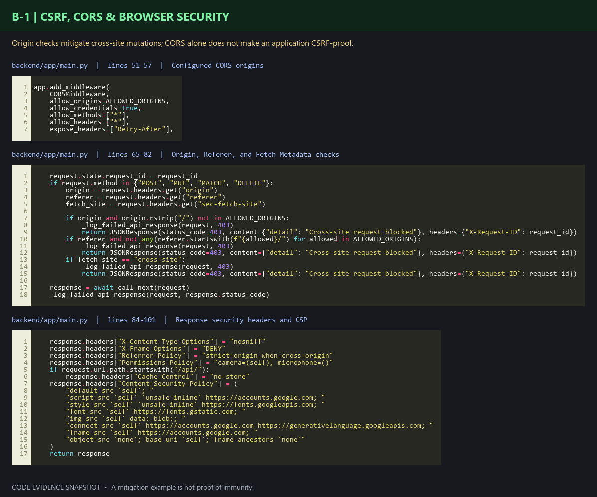

#### Figure B-2. SQLAlchemy ORM queries and parameter binding

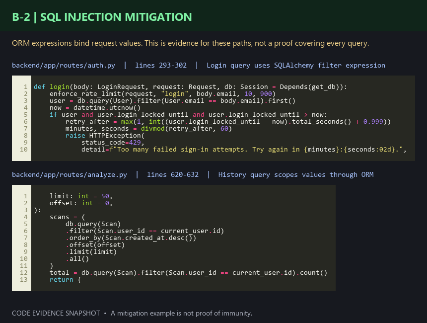

#### Figure B-3. React text rendering and the current Content Security Policy

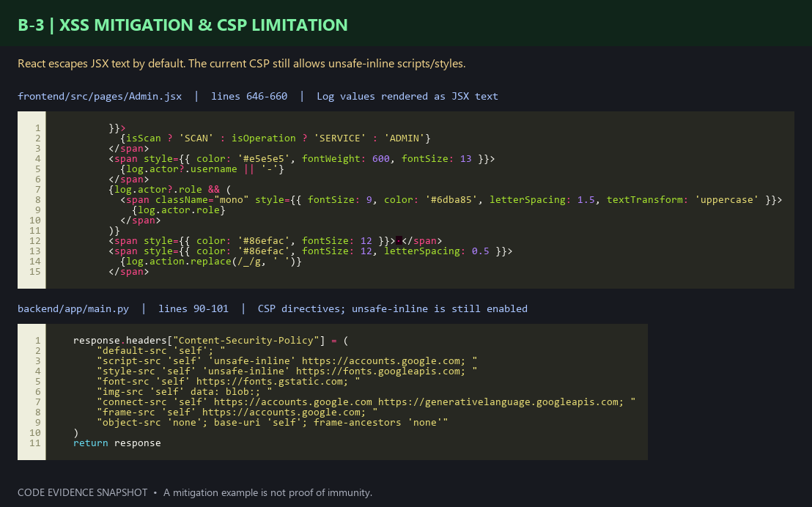

#### Figure B-4. Password hashing, password policy, and progressive login lockout

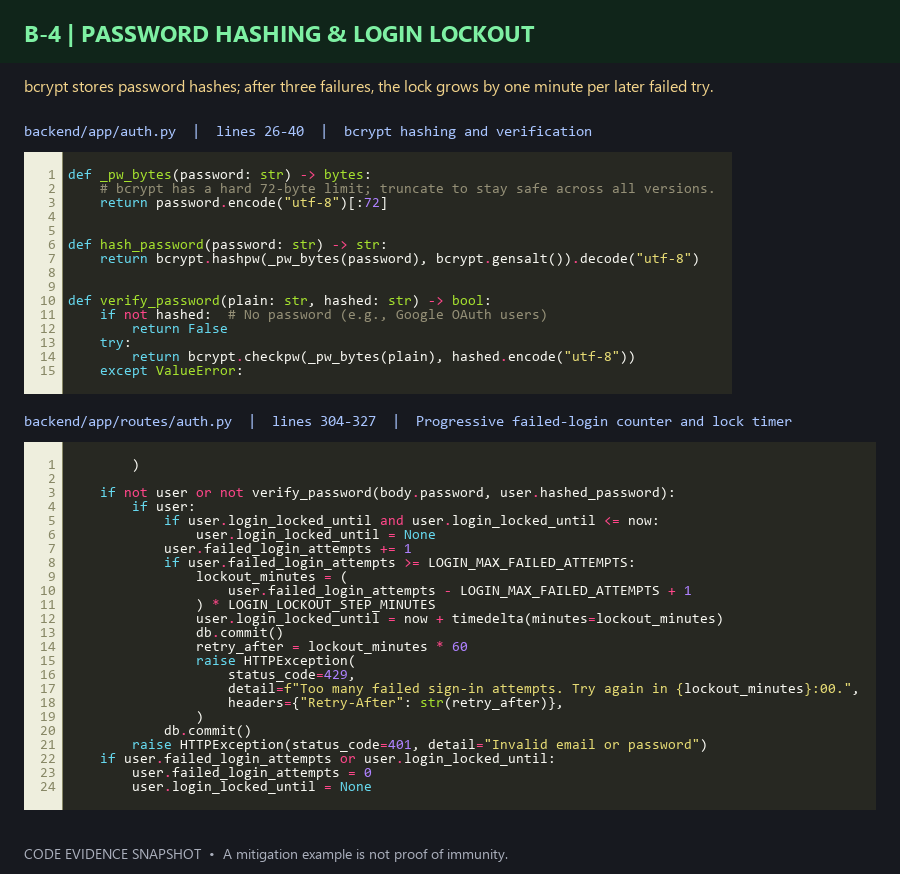

#### Figure B-5. Admin permission checks and scan ownership filtering

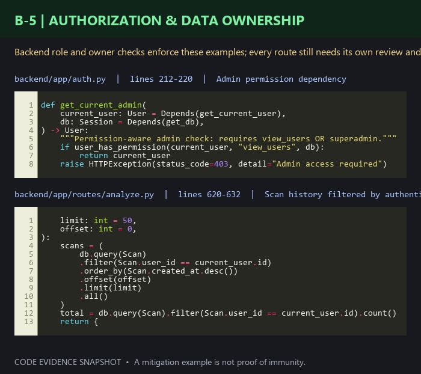

#### Figure B-6. Image upload processing and the missing route-level size cap

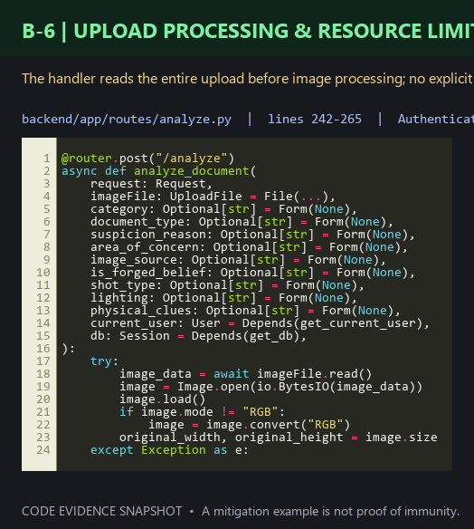

#### Figure B-7. API-key encryption and production configuration checks

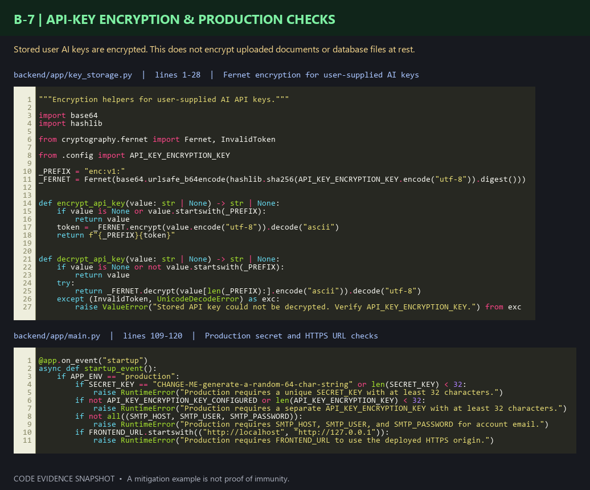

#### Figure B-8. Server-enforced admin idle timeout

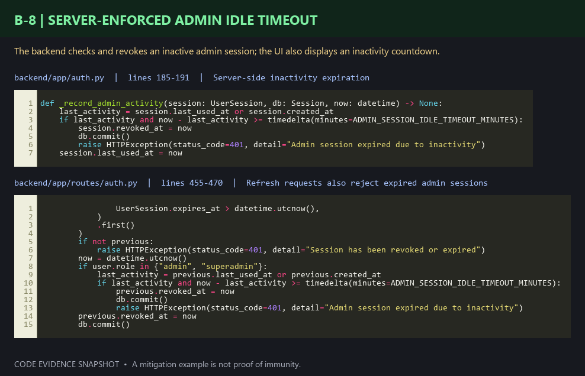

#### Figure B-9. Rate limiting, request-failure records, and scan log feed

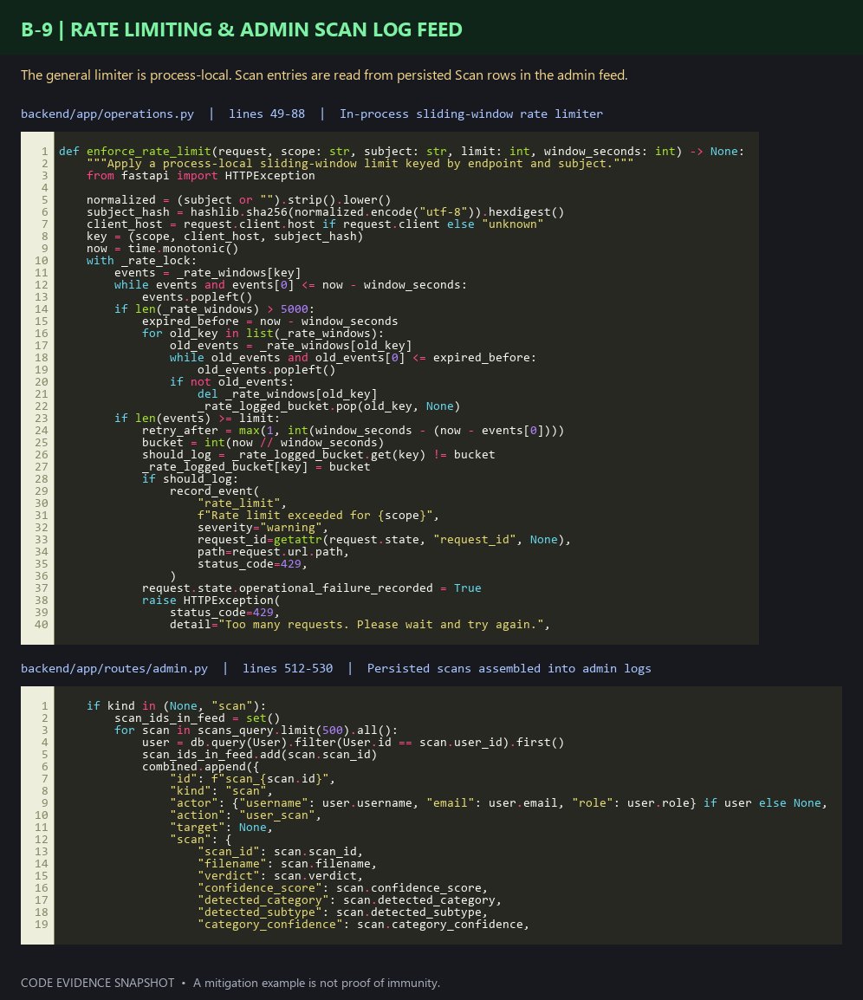

#### Figure B-10. Document image sent to the configured AI provider

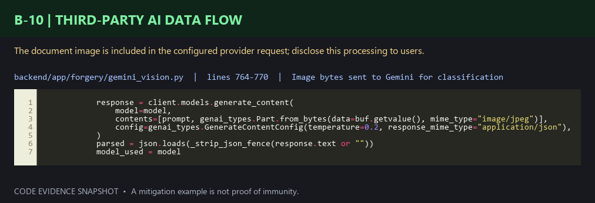

#### Figure B-11. Dependency declarations and production checks

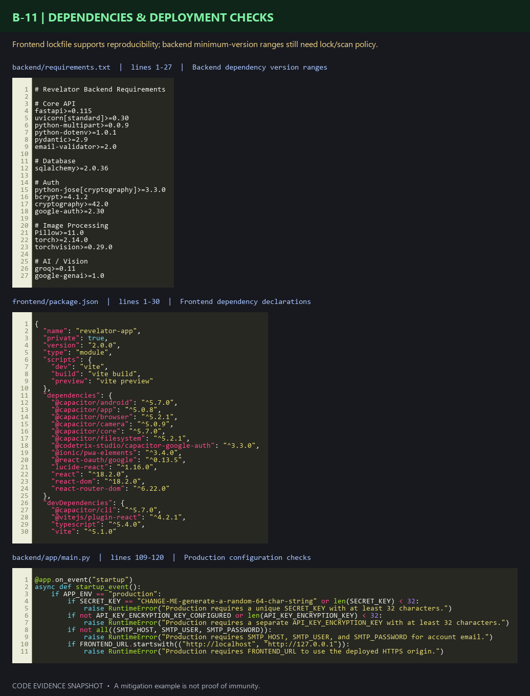

### B.3 Priority actions before production use

1. Enforce upload byte-size, image-dimension, and processing-time limits at both the reverse proxy and application boundary.
2. Deploy only behind a correctly configured HTTPS reverse proxy; enable HSTS after confirming all relevant subdomains support HTTPS.
3. Replace the CSP `unsafe-inline` allowances with nonces or hashes where the frontend permits it, and keep user/AI content as escaped text.
4. Add automated SQL injection, XSS, CSRF, authorization-boundary, and file-upload abuse tests; have an independent reviewer perform a penetration test before handling real sensitive documents.
5. Use a shared rate limiter for multi-worker deployments, and centralize alerts/log retention with access controls.
6. Encrypt database files, uploaded documents, and backups at the storage layer; define retention and deletion periods for personal documents.
7. Add backend dependency locking/scanning and regular patch reviews; keep the frontend lockfile current.
8. Document which AI provider receives each image, the provider's retention terms, and the user's consent/notice path.
